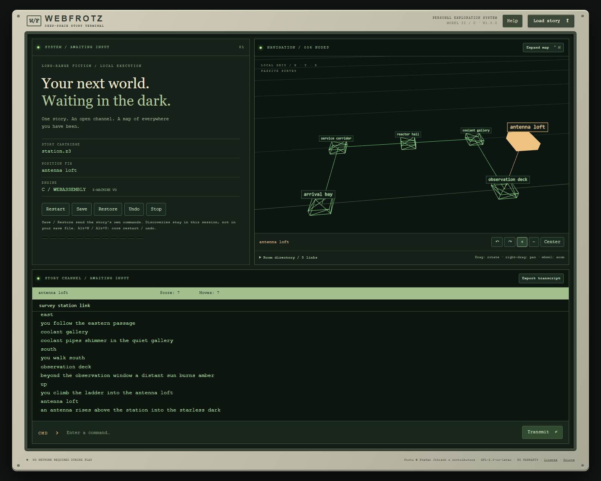

# WebFrotz 1.0

A deep-space story terminal: ivory hardware, phosphor-green text, dark CRT
surfaces and an instrument-panel map. Built with **Vue 3, TypeScript, Vite and
Three.js**, executing the **actual Frotz C interpreter in WebAssembly**.



*Actual browser gameplay using the original generated survey-station fixture.
The populated map, room labels and vertical link come from the C interpreter
and portable map model, not a mockup. No commercial story text is shown.*

**[Play WebFrotz in your browser](https://chaynes89.github.io/WebFrotz/)** —
load a story you are entitled to play. Game data stays in your browser;
GitHub Pages serves only the static app, WASM and original generated fixtures.

## Download 1.0

Get **[WebFrotz 1.0](https://github.com/chaynes89/WebFrotz/releases/tag/v1.0.0)**.
The release includes `webfrotz-1.0.0-static.zip`, a ready-to-serve site with the
real WASM interpreter, plus `webfrotz-1.0.0-source.zip` from the same passing
commit. Extract the static archive and serve its root over HTTP(S), for example:

```powershell
python -m http.server 4179 --bind 127.0.0.1
```

Open `http://127.0.0.1:4179/`; opening `index.html` directly will not work.
No commercial games are bundled. The supported versions and browser limitations
below also apply to 1.0; a stable release does not imply complete desktop parity.
Retain `COPYING.txt`, `SOURCE.txt` and the notices in `licenses/` when
redistributing. Provide the matching corresponding source under the GPL;
see [DEPENDENCIES.md](DEPENDENCIES.md) and [PROVENANCE.md](PROVENANCE.md).

## Play

Load a raw Z-machine **V1, V2, V3 or V5** story (`.z1`, `.z2`, `.z3`, `.z5`) you are
entitled to play. No commercial games are bundled. Stories and commands are
processed locally; there is no backend, analytics or story upload.

- Type commands and press Enter. Up/Down recalls command history. Single-key
  prompts also work. The transcript is selectable, scrollable and exportable.
  Desktop panels adapt to the viewport height, keeping the command bar visible
  in both docked and expanded map views. Transcript, system content, room directory
  and Help scroll inside their panels. Narrow/mobile screens keep a stacked layout
  with page scrolling where needed.
- **Help** opens common example phrases without issuing a command or changing
  the game. Story vocabulary stays hidden until you select **Reveal story
  vocabulary (spoilers)**. Opening Help again hides it by default. The spoiler
  warning explains that dictionary keys can expose unseen objects or puzzle clues.
  Keys come from the loaded file's actual standard header dictionary for V1-V3/V5,
  not a fabricated vocabulary or a list of guaranteed valid phrases. V1-V3 keys
  have at most 6 encoded Z-characters; V5 has 9, so displayed keys can be truncated.
  V5 custom alphabets and standard/custom ZSCII Unicode tables are supported.
  Alternate dictionaries, custom parser vocabulary and runtime dictionary changes
  are not inspected. Malformed tables, unsupported dictionary abbreviations or
  character encodings produce an explicit Help error without stopping gameplay.
  Extraction is read-only, local and performed only on explicit reveal; nothing
  is sent, saved, added to the transcript or passed back into the C interpreter.
- For **V1-V3**, rooms come from actual status-room events. Direction commands create map
  connections using the retained portable C++ model; dashed links indicate
  inferred movement. This is observation-based mapping, not a complete world model.
  **V5 does not provide these room events**: its story-defined upper window is
  displayed as text, and the map explicitly reports that automatic mapping is
  unavailable. No room identities are guessed from prose, globals or status text.
  Map title boxes fit each label's measured text with compact padding and a
  smaller font, rather than reserving a fixed-width panel for every room.
- **Ctrl+M** or **Expand map** toggles the upper-right docked map and expanded
  view. The transcript remains full width below it. Drag to rotate, right-drag
  to pan and wheel to zoom. Focus the map for arrow-key panning; buttons provide
  rotation, zoom and centering. The room directory remains usable without WebGL.
- **Restart** confirms before replacing the worker and clearing progress,
  transcript and discoveries. **Stop** terminates even a busy/pending interpreter.
  Loading another story creates a fresh worker.
- **Save / Restore** send `save` / `restore` to the story's parser. Successful
  saves download real Quetzal `.qzl` files. Restore asks you to choose a file
  (or cancel); the interpreter checks story identity. Some games have their own
  prompts or different command vocabulary. Follow their prompts as usual.
- **Undo** uses the core's existing hot-key undo at a line-input boundary.
  With the command field focused, **Alt+U** invokes undo and **Alt+N** invokes
  the core's restart confirmation (answer its single-key y/n prompt). Core
  restart retains transcript history, unlike the toolbar's full session reset.
  Successful restore/undo retains discovered rooms but discards pending traversal.
  In V5, undo depends on the story creating undo checkpoints; unavailable undo
  is reported by the core.
- **Browser maps are not included in Quetzal saves.** In the browser they are
  stored with the automatic progress described below; keep downloaded saves for
  portable game progress.

### Browser library and autosave

The browser build keeps an **IndexedDB** library on this device. Nothing is
uploaded; there is still no backend.

- **Imported stories are stored automatically.** The full story bytes are
  stored, keyed by SHA-256 of their contents, so later the **Browser library**
  panel can reopen them without choosing the file again. **Forget** (confirmed)
  deletes that story with its autosaves and map. It never deletes downloaded
  save files.
- **Progress autosaves at every line-input prompt.** The real interpreter
  writes a Quetzal snapshot (memory, stack and program counter) before waiting
  for your command. This is not just the map or transcript. The snapshot,
  status line, last 256K characters of transcript and the V1-V3 map are stored
  together. The **AUTOSAVE** readout shows the last stored time.
- **Opening a story with an autosave asks first:** **Resume autosave**, **Resume
  earlier run** (if one exists), **Start new game** or **Cancel**. Nothing is
  overwritten before you choose. Resuming starts the real interpreter, restores
  the snapshot at the prompt, then waits for your next command. The transcript
  and map are restored from the same stored record. Undo history starts from the resumed
  turn. As with Restore, a V3 split upper window is cleared on resume until the
  game redraws it. V5 restores its saved upper-window text.
- **Two slots are kept per story:** the latest checkpoint of the current run and
  the latest checkpoint of one earlier run. **Restart**, the in-game restart or
  Start new game moves the existing autosave to the earlier slot at the new
  run's first prompt, replacing any older earlier run. If the same run advanced
  elsewhere after you chose to resume (for example in another tab), that newer
  checkpoint is moved to the earlier slot rather than overwritten.
- Autosaves are internal mid-input checkpoints and **cannot** be loaded with the
  story's Restore command. Use **Save** for portable `.qzl` files. Single-key
  prompts (such as "press any key") are not checkpoints, so progress after the
  last line prompt is not autosaved.
- If the same story is open in another tab, autosave is **paused** there (Web
  Locks), so two tabs cannot keep overwriting each other's progress.
- Storage failures are shown, never silent. Examples include quota exceeded,
  IndexedDB being unavailable (some private modes) or a damaged record. For a
  failed autosave, the alert and amber AUTOSAVE readout say that recent progress
  is not stored; play continues, so use Save. A record that cannot be read
  disables autosave for that session and is left unchanged.
- Storage is **per browser profile and per origin**. GitHub Pages, `localhost:4175`
  and other ports or hosts each have separate libraries. Clearing site data or
  browsing data, private or incognito windows, and browser eviction under storage
  pressure remove it. **Request persistent storage** asks the browser to exempt
  the site from eviction; it may decline.
- The Windows desktop app does not use browser autosave. It keeps its existing
  native path/map library and manual saves described below.

## Windows desktop (Tauri 2)

The optional **Tauri 2** app embeds the same Vue/Three.js frontend, Web Worker
and real C/WASM interpreter. It is not a separate interpreter port. The browser
build and its browser-local library/autosave remain unchanged.

Each passing `main` CI run produces a **webfrotz-windows-installer** artifact
containing an x64 per-user NSIS installer and the matching source zip. This is
a development artifact, not a new tagged release. Download it from
[Actions](https://github.com/chaynes89/WebFrotz/actions), extract it and run the
setup executable. **No Node, Python, Rust, Emscripten or local HTTP server is
needed on the player's machine.** The installer includes Microsoft's signed
WebView2 offline installer for machines without the runtime; installation and
gameplay do not require downloading app assets. WebView2 may separately update
itself when online. The WebFrotz installer is currently unsigned: Windows may
show SmartScreen/unknown-publisher warnings. There is no updater or telemetry
service in WebFrotz.

- **Load story** uses the native Windows picker; recent stories can be reopened
  from the **Local library** panel. Only paths are remembered, not copies of
  story files. The last ten entries are keyed by SHA-256 of the full story,
  so changed contents cannot accidentally reuse another story's map/save history.
  A missing/moved/changed recent file reports an error; use Load story again.
- **Save** uses a native Save As dialog for the actual Quetzal output. **Restore**
  offers a native picker or **Use last local save** for this exact story.
  The C interpreter still verifies saves. Cancelling a picker is not a successful
  save/restore. Export transcript also uses a native Save As dialog.
- V1-V3 map discoveries are stored locally per story in the portable map model's
  coordinates, with identities, names and links intact. Reopening starts a
  **fresh game with retained discoveries**, not an automatic game restore.
  Restore a `.qzl` to resume progress. Imported maps have no stale current room
  or pending movement, so reopening/restore cannot invent a connection.
  **Restart clears discoveries**; restore and undo retain them. V5 still has no
  automatic room telemetry. Maps are separate from Quetzal saves and contain
  previously discovered room names (potential spoilers).
- Closing confirms that unsaved game progress and transcript will be lost,
  and waits for pending map writes. **There is no automatic game save.**
  **Clear local history and maps** confirms, stops the current session and
  removes remembered paths/maps, but never deletes original stories or saves.

Local data lives under `%LOCALAPPDATA%\io.github.chaynes89.webfrotz`, not in the
repository. Storage replacement retains a recovery backup. Storage, invalid-map,
read/write and missing-file errors are surfaced; a damaged library prevents
startup with a native error message rather than silently discarding data.
For recovery, close the app and move its `library.json`/`library.backup` aside
(or the affected `<story-sha256>.json`/`.backup` map files); reopen with Load story.
Keep your `.qzl` files. Uninstalling should not be relied on to erase private
WebView2/local data; clear it explicitly.

### Build the Windows installer

Use **Windows x64**, Node 24 LTS, Python 3.10+, Emscripten 4.0.18, the pinned
Rust toolchain in `rust-toolchain.toml`, **Visual Studio 2022 Build Tools**
with **Desktop development with C++** (MSVC and Windows SDK), and WebView2 for
local development. See [Tauri prerequisites](https://v2.tauri.app/start/prerequisites/).
Build dependencies/runtime installers need internet access on the build machine.
`Cargo.lock` and `package-lock.json` pin dependencies; this is a reproducible
build procedure, not a promise of byte-identical executables (the offline
Evergreen WebView2 installer is resolved at bundle time).

```powershell
npm ci
npm run build:wasm
npm run desktop:dev
```

Desktop development uses **4180** with strict port selection, never 4175.
The production hook rebuilds WASM, generates only original fixtures, checks
TypeScript, builds into `.build\desktop-dist`, collects dependency/source notices,
and embeds it in the native executable:

```powershell
npm run desktop:build -- --ci -- --locked
cargo test --locked --manifest-path src-tauri\Cargo.toml
```

Installer output: `src-tauri\target\release\bundle\nsis\`.
The original icon source is `docs\app-icon.svg`; regenerate with
`npx tauri icon docs\app-icon.svg`.
The frontend build never overwrites `dist`, so existing browser previews stay
intact. Both app assets and bundled GPL/dependency notices are available offline.
Redistribute the matching corresponding source and all notices, not just the
installer; see [DEPENDENCIES.md](DEPENDENCIES.md).

Windows CI builds the actual NSIS installer, runs Rust storage regressions and
launches an **optimized Tauri executable/WebView2**, loading a generated story
through the real native picker. It exercises WASM gameplay, map toggle, native
save/restore/export, close/reopen persistence, restart and clearing history.
After building the production installer, CI compiles a separate, unbundled
`desktop-smoke` variant with `tauri.smoke.conf.json`: the only differences are
DevTools support and CDP port **4181**, passed through the WebView2 API because
elevated WebView2 150+ ignores environment flags. The distributed installer
uses the original configuration and does not enable a debugging port.
Browser adapter tests separately
mock native IPC but run the actual WASM map-import path.
The local implementation machine lacked MSVC/Windows SDK; local checks cover
TypeScript, real WASM/portable regressions and browser interaction, while the
Windows job is the authoritative installer/native integration check.

No file associations, command-line story opening, drag/drop, macOS/Linux
installers, signed binaries or automatic updates are provided in this first
desktop integration. Interpreter/media/version limitations below still apply.

## Build and develop

Use Node.js **24 LTS** (24.0 or later), Python **3.10+**, and Emscripten
**4.0.18**. Node 22.12+ is also supported by the frontend tooling.
Dependencies are pinned in `package-lock.json`; the SDK version is pinned in CI.

Install Emscripten using its official [emsdk](https://emscripten.org/docs/getting_started/downloads.html).
For a workspace-local Windows installation, from this repository:

```powershell
git clone --depth 1 https://github.com/emscripten-core/emsdk.git .build\emsdk
.\.build\emsdk\emsdk.bat install 4.0.18
.\.build\emsdk\emsdk.bat activate 4.0.18
npm ci
npm run build:wasm
npm run dev
```

The Python builder detects Emscripten on PATH, under `EMSDK`, or in
`.build\emsdk`. It compiles the C99 core separately from the C++14 map model,
renames only the core entry point, and links a worker-only ES module with Asyncify.
The browser adapter uses GNU C99 because Emscripten's `EM_ASM` requires it;
the core remains C99. Generated `public\wasm` artifacts are intentionally ignored.
The SDK itself is workspace-local and ignored; no system-wide activation is required.

On Linux/macOS, activate emsdk in the current shell before the same npm commands.
The Python scripts handle platform-specific paths.

```powershell
npm run build:wasm
npm run build
npm run preview
```

Serve `dist` over HTTP(S), with `.wasm` served as `application/wasm`.
Do not open `index.html` directly as a file. No SharedArrayBuffer, cross-origin
isolation headers or threading are required. The app must fetch its worker and
WASM module when a story starts, so this is not an offline-installed PWA.
Once loaded, play does not require network requests.

For hosting below a URL prefix, set `WEBFROTZ_BASE` before building:

```powershell
$env:WEBFROTZ_BASE = "/WebFrotz/"
npm run build
```

CI produces a `webfrotz-static-site` artifact. The separate GitHub Pages workflow
validates a `/WebFrotz/` build and automatically deploys passing `main` builds to
**https://chaynes89.github.io/WebFrotz/** using the official Pages actions.
Desktop builds explicitly use `/`, regardless of `WEBFROTZ_BASE`.
No release or version tag is created automatically. Passing CI also produces
`webfrotz-release-assets` with versioned static and matching-source zip files,
including GPL and runtime dependency notices. To package a committed version
locally after building, run `npm run package:release`.

## Verification

```powershell
npm run fixtures
npm test
npm run test:portable:wasm
npm run build
npx playwright install chromium
npm run test:browser
```

Browser tests run against the production build, load generated original V1-V3/V5
stories, and execute real Z-machine instructions through WASM. They cover text,
status score/moves, movement/map links, toggle, restart, save/restore/cancel,
undo, replacement, stop, browser-library reopening, autosave resume, earlier-run
recovery, second-tab pause and visible storage failures, viewport-height desktop and narrow layouts, Help and
spoiler-gated vocabulary, WebGL fallback, V5 length scaling,
V5 upper-window coordinates and explicit timed-input rejection. The fixture generator
is a tiny bytecode assembler, not the application's interpreter.
Screenshots are written to `test-results`.

To test an update without changing the static files served by an existing
unsaved preview, build into a separate directory and point browser tests at it:

```powershell
npx vue-tsc --noEmit
node .\node_modules\vite\bin\vite.js build --outDir .build\help-preview
$env:WEBFROTZ_TEST_DIST = ".build\help-preview"
npm run test:browser
```

The test server uses port 4173, separate from the optional local preview on 4175.

`npm run test:pages` checks the live Pages URL using only `station.z3`, validating
the worker/WASM paths, six-room gameplay with a vertical connection, map toggle
and restart. `WEBFROTZ_PAGES_URL` may select an isolated loopback `/WebFrotz/`
preview; this script refuses the protected preview ports.

The README image is reproducible using only the original generated `station.z3`
fixture. With an isolated build preview on port 4178, run `npm run screenshot`.
`WEBFROTZ_SCREENSHOT_URL` may select another loopback preview; the capture tool
refuses ports 4175/4176 to avoid existing user sessions. It executes actual
commands, checks six discovered rooms and a vertical movement, then captures
the unmodified UI. The fixture is a small opcode test story, not a full adventure.

Native portable regressions need CMake 3.20+, Python and a C/C++ compiler:

```powershell
cmake -S . -B .build\portable -DBUILD_TESTING=ON
cmake --build .build\portable --config Debug
ctest --test-dir .build\portable -C Debug --output-on-failure
```

CI runs native core/model regressions on Linux plus Emscripten/Node regressions
and Chromium gameplay tests. The retained core suite covers V1/V2/V3/**V5**,
including host events, saves/restores, undo and playback. Browser V5 support is
text-oriented and narrower than the core's full capabilities.

### Optional private story smoke tests

With a local production preview running (default port 4175):

```powershell
$env:WEBFROTZ_LOCAL_STORIES = "D:\Stories"
node tools\test_local_stories.mjs
```

Set `WEBFROTZ_PREVIEW_URL` if your local preview uses another URL. This opt-in
script reads authorized local files directly into the local browser, checks
load/look/inventory/north/look, and checks Quetzal save/restore for V5. It writes
no story files, transcript, screenshots, trace or video, and never runs in CI.
Only filenames, header versions and success/unsupported/failure metadata are logged.

Local smoke testing on 2026-11-01:

| Local filename | Actual header | Result |
| --- | --- | --- |
| `ADVENT.Z5` | V5 | Text commands and Quetzal save/restore passed |
| `FREEFALL.Z5` | V5 | Requires timed input; explicitly unsupported |
| `hhgg.z5`, `planetfall.z5` | V3 | Text command smoke checks passed |
| `zork_1.z5`, `zork_2.z5` | V2 | Text command smoke checks passed |

The header, not the extension, determines the version. These are initial smoke
checks, not full-game walkthroughs or a guarantee of complete compatibility.
No user-owned story bytes or story text are distributed here.

## Boundaries and current limitations

| Layer | Responsibility |
| --- | --- |
| `Generic/` | Upstream C interpreter and neutral `os_*` / `host_events.h` interface |
| `web/host.c` | Browser display/file/input adapter; Asyncify suspends blocking input |
| `Frontend/AutoMap.*` + `web/map_bridge.cpp` | Retained map semantics plus a small browser ABI |
| `src/engine/` | Typed worker protocol, session lifecycle and filesystem/download bridge |
| `src/components/RoomMap.vue` | Three.js rendering and camera interaction only |
| `src/App.vue` | Vue terminal and hardware-themed controls |

Host notifications are synchronous and never re-enter the interpreter. Borrowed
UTF-16 commands are copied immediately. Only asynchronous host input/file waits
resume execution. Periodic worker yields allow responsiveness; stopping/replacing
uses worker termination instead of trying to interrupt/re-enter the C core.

The browser supports **raw, text-oriented V1-V3 adventures** (maximum
128 KiB) and **V5** (maximum 256 KiB, four-byte header length units).
V4, V6-V8, Blorb, Glulx, pictures, sampled sound/music, timed input,
mouse opcodes, story menus, auxiliary files, command recording/playback and
interpreter-managed script files are not supported. Relevant unavailable
operations report an error or notice rather than pretending to work.

The host uses an **80-column / 30-row** logical screen, a reflowing lower
transcript and a cursor-addressed plain-text upper window. Fonts, text styles and
story-selected colours are not reproduced; the readable retro theme is fixed.
Unusual screen tricks can differ from desktop presentation. WebGL failure
degrades to the accessible room directory; losing its context requires a reload
to recover graphics. Reduced-motion disables scanline/glow effects; the map has
no idle animation.

Header validation rejects unsupported/truncated images, but it is not a complete
validator for malicious Z-machine bytecode. Load trusted stories. The interpreter
runs inside browser WebAssembly memory, not as a native executable.
In the browser, the transcript tail, map and progress snapshot autosave to IndexedDB as described above;
undo history, single-key prompt state and in-flight output after the last line prompt are not persisted.
V5 timed-input requests fail with a specific capability error; a real-time story
such as Freefall is not currently playable. Full timed-input support needs an
asynchronous timeout/interrupt bridge, not a fabricated immediate key or disabled timer.
Broader compatibility beyond the private smoke checks above requires further
testing with legitimately obtained stories.

## Attribution

Migrated from `chaynes89/Windows-Frotz-Automap` v0.1.0,
commit `909fa642e3989d788016566e63d8e038e1fc9b1f`, derived from
David Kinder's Windows Frotz and Stefan Jokisch's Frotz.
The portable core/model and their headers are retained; Windows resources and
media dependencies are not part of this migration.
See [PROVENANCE.md](PROVENANCE.md), [COPYING](COPYING) and [LICENSE](LICENSE).
**GPL-2.0-or-later; no warranty.**

The interpreter's GPL does not license separately copyrighted story files.
Ownership of a game copy does not normally grant redistribution rights.
Do not add commercial/unauthorized stories; redistribute a story only with
explicit permission or verified public-domain status and its required notices.
